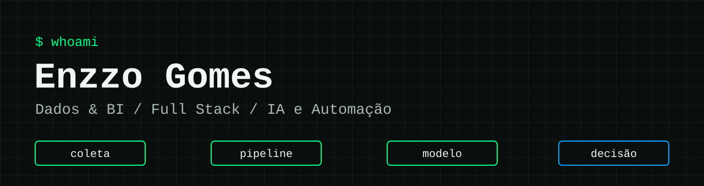

  

  
  
  

Construo sistemas que transformam dados e processos manuais em decisões, de pipelines com Power BI a plataformas web em uso real. Estudo Ciência de Dados e Inteligência Artificial na Universidade de Sorocaba (Uniso).

## Projetos em destaque

| Projeto | O que faz | Stack | Links |
|---|---|---|---|
| **C²SYSTEM** | Plataforma SaaS multiempresa para gestão de mídia exterior, com contratos, reservas, financeiro e relatórios. 211 testes automatizados. | PHP 8, MySQL | [Detalhes](https://portifolioenzzogomes.vercel.app) (código privado) |
| **Estufa + Power BI** | Pipeline IoT com mais de 47 mil leituras de sensores e médias de 15 minutos enviadas ao Power BI, sem custo de infraestrutura. | Python, PHP, MySQL, Power BI, GitHub Actions | [Código](https://github.com/EnzzoGomes/estufa-powerbi) · [Painel](https://estufa.freedev.app) |
| **Mission Market** | Marketplace de tarefas e serviços locais, com autenticação e níveis de usuário. | Next.js, TypeScript, Supabase | [Código](https://github.com/EnzzoGomes/projeto-app) · [Demo](https://projeto-app-gamma.vercel.app) |
| **conecta.uniso** | Plataforma de cursos com área do aluno, painel administrativo, quizzes e certificados. | JavaScript | [Código](https://github.com/EnzzoGomes/site-letramento) · [Demo](https://site-letramento.vercel.app) |
| **AI English Tutor** | Tutor de inglês com IA, com plano de estudos e simulação de conversas. | LLM, TypeScript | [Página](https://github.com/EnzzoGomes/ai-english-tutor) · [Demo](https://huggingface.co/spaces/Enzzozink/tutor-ingles-ia) |

## Stack

**Dados e automação**

    

**Desenvolvimento**

     

**Bancos e infraestrutura**

   

**Em aprofundamento, com cursos e certificações**

       

## Certificações

Oracle Cloud Infrastructure Foundation · IBM Artificial Intelligence Fundamentals · AWS SimuLearn: Fundamentos da Computação em Nuvem
